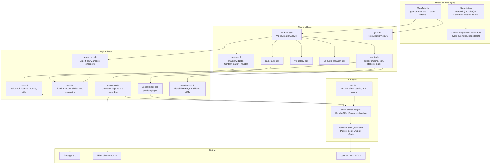

# How the Banuba Video Editor / Photo Editor SDK works (Android)

A study of the SDK as used by this integration sample (VE SDK `1.54.3`, PE SDK `1.4.3`).

- [Method and sources](#method-and-sources)
- [The big picture](#the-big-picture)
- [Module map](#module-map)
- [Startup and licensing](#startup-and-licensing)
- [Dependency injection is the integration API](#dependency-injection-is-the-integration-api)
- [Launching the editor and getting results back](#launching-the-editor-and-getting-results-back)
- [Inside the video pipeline](#inside-the-video-pipeline)
- [The AR layer (Face AR SDK)](#the-ar-layer-face-ar-sdk)
- [Content: LUTs, AR effects, audio](#content-luts-ar-effects-audio)
- [Build and packaging requirements explained](#build-and-packaging-requirements-explained)
- [How the SDK has evolved](#how-the-sdk-has-evolved)
- [Observations about this sample](#observations-about-this-sample)

## Method and sources

The SDK is closed-source and ships as AARs from `https://nexus.banuba.net/repository/maven-releases`. This
study was put together from:

1. **This repository**: `app/build.gradle`, `SampleApp.kt`, `VideoEditorModule.kt`, `MainActivity.kt`,
   `Utils.kt`, `AndroidManifest.xml`, `proguard-rules.pro`, and the bundled assets.
2. **The full git history of the upstream repo** `Banuba/ve-sdk-android-integration-sample`, about 530
   commits from 2020 to 2026. Earlier versions of the sample shipped about 70 detailed guides in `mddocs/`
   (export, recording, effects, AR Cloud, drafts, audio, FAQ, dependency lists) that are now gone from
   `main`. They were recovered from history.
3. **`Banuba/banuba-sdk-android-samples`**: the public samples for the Face AR SDK, the AR engine that
   the Video Editor uses for masks and beauty effects.

What this study did **not** do: it did not download or decompile the AARs. The Banuba Maven host and
`docs.banuba.com` were not reachable from the environment the study ran in. Statements are marked like
this:

- **[verified]**: read directly in code or official Banuba docs and samples.
- **[inferred]**: deduced from API shapes, build settings or dependency lists. It's probably right, but
  check it against the binaries before you depend on it.

## The big picture

The VE SDK is **a complete, ready-made UI flow, not a toolkit of views**. You don't put its screens into
your layouts. You start one Activity, `VideoCreationActivity`, from an intent factory. The SDK then takes
over the camera → trimmer → editor → export flow and returns an `ExportResult` through an
`ActivityResultContract` **[verified]**.

There are two ways to customize it:

1. **Koin dependency injection**: every behavior (configs, providers, export flow, content sources) is a
   Koin binding that you can override **[verified]**.
2. **Android resource overriding**: themes, styles, strings and drawables with fixed names
   (`visual_effect_{id}`, `ic_transition_{id}` …) that your app redefines **[verified]**.



## Module map

These are all the Gradle artifacts the sample declares in `app/build.gradle`, with the role each one
plays. A role is **[verified]** when it is backed by a Koin module or a class used in this repo, and
**[inferred]** otherwise.

| Artifact | Koin module | Public entry points used here | Role |
|---|---|---|---|
| `core-sdk` | (internal) | `EditorSdk`, `EditorUtilityManager`, `TrackData`, `obtainReadFileDescriptor` | License gate, shared models, utilities |
| `core-ui-sdk` | (internal) | `ContentFeatureProvider`, `visible()` ext | Shared UI widgets and the "pluggable content screen" contract |
| `ve-sdk` | `VeSdkKoinModule` | `SlideShowTask`, `SlideShowSource`, `SlideShowScaleMode` | Core video model; slideshow (images → mp4); FFmpeg wrapper |
| `ve-flow-sdk` | `VeFlowKoinModule` | `VideoCreationActivity`, `VideoExportResultContract` | The Activity that runs the whole flow |
| `ve-ui-sdk` | `VeUiSdkKoinModule` | (screens) | Editor, trimmer, timeline, text/sticker and music editors |
| `camera-sdk` / `camera-ui-sdk` | (pulled in by the flow) | `PipConfig` | Camera2 capture, recording, PiP, timer and hands-free modes |
| `ve-gallery-sdk` | `GalleryKoinModule` | (screen) | Built-in media picker |
| `ve-effects-sdk` | (internal) | (keep rules for `core.effects`, `effects.ve.speed`) | FX, time effects, transitions, LUT application |
| `ve-playback-sdk` | `VePlaybackSdkKoinModule` | (internal) | Real-time preview player on the editor screen |
| `ve-export-sdk` | `VeExportKoinModule` | `ExportResult` | Rendering and encoding to `.mp4`, foreground or background |
| `ve-audio-browser-sdk` | `AudioBrowserKoinModule` | `AudioBrowserMusicProvider` | In-SDK music picker (device library and Mubert) |
| `effect-player-adapter` | `BanubaEffectPlayerKoinModule` | (internal) | Bridge from the VE SDK to the Face AR SDK effect player |
| `ar-cloud` | `ArCloudKoinModule` | `ArEffectsRepositoryProvider` | Downloads AR effects from Banuba's servers and caches them on the device |
| `ffmpeg:5.3.0` | n/a | n/a | Native FFmpeg build (LGPL), versioned separately from the SDK |
| `pe-sdk` | n/a | `PhotoCreationActivity`, `PhotoExportResultContract` | Photo Editor. Shares the license with the VE SDK |

Removing a feature means removing **both** its Gradle artifact **and** its Koin module. For example,
leaving out `BanubaEffectPlayerKoinModule` and `effect-player-adapter` turns Face AR off: about 40 MB with
AR versus about 17 MB without, per the FAQ **[verified]**.

## Startup and licensing

```mermaid
sequenceDiagram
    participant App as SampleApp.onCreate
    participant Koin as Koin (global)
    participant Sdk as EditorSdk
    participant Main as MainActivity
    participant VCA as VideoCreationActivity

    App->>Koin: startKoin { androidContext; allowOverride(true); modules(...) }
    App->>Sdk: EditorSdk.initialize(LICENSE_TOKEN)
    Sdk-->>App: EditorSdk instance, or null if the token is malformed
    Main->>Sdk: getLicenseState { isValid -> ... }  (async, up to ~1 s)
    alt valid
        Main->>VCA: launch(VideoCreationActivity.startFromCamera(...))
        VCA-->>Main: ExportResult via VideoExportResultContract
    else expired or revoked
        Main->>Main: disable buttons and show ERR_LICENSE_REVOKED
    end
```

What the code shows **[verified]**:

- **Two-stage license check.** `EditorSdk.initialize(token)` runs synchronously and returns `null` when the
  token is empty, truncated or otherwise malformed (`ERR_SDK_NOT_INITIALIZED`). Then
  `getLicenseState(callback)` reports asynchronously whether the license is active. Expiry and
  revocation are reported here. The sample notes that it "might take up to 1 sec".
- **One license object for both products.** Since `1.52.0`, `EditorSdk` (in `com.banuba.sdk.core.license`)
  replaced the separate `BanubaVideoEditor` and `BanubaPhotoEditor`. Before that, the sample had to
  null out one instance before creating the other ("It is required to keep only one instance").
- **Features are gated by the license.** PiP will not open without it. The list of visual effects
  "depends on license". The Photo Editor returns a `null` URI when "the token does not support Photo
  Editor SDK". An expired license shows a "Video content unavailable" screen inside the flow.
- **The license is checked again at use time.** `EditorUtilityManager` "is NULL when the token is expired
  or revoked" and isn't declared explicitly in DI. So some engine objects are created only after the
  license allows it.
- **Remote tokens are supported (older versions).** The 2022 docs describe `TokenType.REMOTE` with a
  Retrofit `RemoteTokenApi`, a `RemoteTokenMapper` and a `remoteTokenUrl`, so the token can be fetched
  from your server instead of being hard-coded. Check that this still exists in 1.54.x.

**[inferred]** The SDK bundles libsodium, an ISC-licensed crypto library listed in the third-party
licenses. Together with the synchronous parse step, this suggests the token is a signed blob verified on
the device. The async step probably adds expiry and server-side revocation checks.

### Releasing the SDK

`SampleApp.releaseVideoEditor()` shows how teardown works: call `EditorUtilityManager.release()`, then
`stopKoin()`, then drop the `EditorSdk` reference. Because Koin is a **process-global** container, the SDK
effectively behaves as a singleton for the whole app. Calling `startKoin` twice without `stopKoin`
throws.

## Dependency injection is the integration API

This is the central design decision. `VideoEditorModule.initialize()` calls:

```kotlin
startKoin {
    androidContext(applicationContext)
    allowOverride(true)
    modules(
        VeSdkKoinModule().module, VeExportKoinModule().module, VePlaybackSdkKoinModule().module,
        AudioBrowserKoinModule().module, ArCloudKoinModule().module, VeUiSdkKoinModule().module,
        VeFlowKoinModule().module, GalleryKoinModule().module, BanubaEffectPlayerKoinModule().module,
        SampleIntegrationKoinModule().module,   // ← yours, last
    )
}
```

With `allowOverride(true)`, **a later definition of the same type and qualifier replaces an earlier one**.
That's why the docs say "keep order of modules" and why your module goes last. Every SDK module
registers defaults; your module swaps in replacements.

The sample overrides two bindings:

| Binding | Why |
|---|---|
| `ArEffectsRepositoryProvider` (`createdAtStart = true`) built from `get(named("backendArEffectsRepository"))` | Switches AR effects to the AR Cloud backend repository. `createdAtStart` makes the catalog start loading at app start |
| `ContentFeatureProvider<TrackData, Fragment>` named `"musicTrackProvider"` → `AudioBrowserMusicProvider()` | Plugs the Audio Browser into the "add music" action. Only one `musicTrackProvider` can exist |

### Override points found in the guides

The historical guides document many other bindings you can override. Names are from 2022–2025 docs, so
check each against 1.54.x:

| Area | Binding (type, or `named(...)`) | What it controls |
|---|---|---|
| Editor | `EditorConfig` | Min/max total duration, max sources (50), which features are on (FX, time FX, music, text, stickers, transitions), GIPHY key, slideshow timing |
| Editor | `MusicEditorConfig`, `ObjectEditorConfig` | Timeline counts, durations, max tracks |
| Editor | `AspectsProvider`, `AspectRatioProvider`, `VideoDrawParams`, `named("editorVideoScaleType")` | Aspect ratios, crop vs. letterbox |
| Camera | `CameraConfig` | Recording limits, flash, speed recording, photo-on-tap, multi-record, FPS mode |
| Camera | `CameraMuteMicConfig`, `CameraRecordingModesProvider`, `CameraTimerStateProvider`, `CameraTimerActionProvider` (`HandsFreeTimerActionProvider`) | Mic default state, photo/video modes, countdown, hands-free |
| Camera | `PipLayoutProvider` | PiP layouts: Floating, TopBottom, React, LeftRight |
| Effects | `named("fxEffectsProvider")` → `EnabledEffectsProvider`, `named("maskOrderProvider")`, `named("colorFilterOrderProvider")` → `OrderProvider` | Which FX are shown, and the order of AR masks and LUTs |
| Text | `TextOnVideoTypefaceProvider` (`MainTextOnVideoTypefaceProvider`) | Fonts for text-on-video |
| Drafts | `DraftConfig` (`ENABLED_ASK_TO_SAVE`, `ENABLED_ASK_IF_SAVE_NOT_EXPORT`, `ENABLED_SAVE_BY_DEFAULT`, `DISABLED`), `DraftsHelper` | Saving drafts |
| Export | `ExportFlowManager` (`ForegroundExportFlowManager`, `BackgroundExportFlowManager`), `ExportParamsProvider`, `named("exportDir")`, `WatermarkProvider`, `PublishManager`, `ExportNotificationManager`, `ExportResultHandler` | How, where and what is exported |
| Audio | `MubertApiConfig`, `named("musicTrackProvider")` | Mubert keys; a custom music picker |

`ContentFeatureProvider` is the generic "hand this step to another screen" contract. It has
`init(hostFragment)`, `requestContent(context, extras)` returning `Result.RequestUi(intent)`, and
`handleResult(...)`. The same contract is used to replace the music picker with your own Activity, which
returns a `TrackData(id, title, localUri, artist)` through `ProvideTrackContract` **[verified]**.

### Resource-level customization

- `AndroidManifest.xml` declares `VideoCreationActivity` with `android:theme="@style/VideoCreationTheme"`.
  This app's `res/` doesn't define that style, so **it comes from the SDK's AAR resources**. You restyle
  the flow by redefining that theme or its child style attributes, for example `loadingScreenTitleStyle`
  **[verified]**.
- Effects, transitions and strings are looked up **by convention-based resource names**, so redefining a
  resource with the same name in your app overrides it. Examples: `visual_effect_flash`,
  `ic_time_effect_rapid`, `visual_effect_color_vhs`, `ic_transition_thumb_fade`,
  `transition_effect_empty` **[verified]**.
- English and Russian ship in the SDK. Other locales are added by translating the SDK's string keys in
  your `values-xx/` folders **[verified]**.

## Launching the editor and getting results back

`VideoCreationActivity` exposes intent factories, one per entry screen **[verified]**:

| Factory | Opens at | Used in `MainActivity` |
|---|---|---|
| `startFromCamera(context, pictureInPictureConfig, additionalExportData, audioTrackData)` | Camera. Pass `PipConfig(video, openPipSettings)` for PiP/duet | "Default" and "PiP" buttons |
| `startFromTrimmer(context, predefinedVideos: Array<Uri>, …)` | Trimmer with pre-loaded clips | "Trimmer" (slideshow) button |
| `startFromEditor(context, predefinedVideos, …)` | Editor | Not used |
| `startFromDrafts(context, predefinedDraft?)` | Drafts list | "Drafts" button |
| `startFromTemplates(context)` | Templates (newer feature) | "Templates" button |

Editor V2 (the redesigned UI, since `1.40.0`) is enabled by passing `bundleOf("EXTRA_USE_EDITOR_V2" to true)`
as extras to any factory **[verified]**.

Results come back through `VideoExportResultContract` as a sealed `ExportResult`:

```kotlin
sealed class ExportResult {
    object Inactive; object Stopped
    data class Progress(val preview: Uri)
    data class Success(val videoList: List<ExportedVideo>, val preview: Uri,
                       val metaUri: Uri, val additionalExportData: Parcelable?)
    data class Error(val type: ExportError)
}
```

`MainActivity` reads `result.videoList.first().sourceUri`. The Photo Editor flow is simpler: it starts
`PhotoCreationActivity.startFromGallery()` or `startFromEditor(imageUri)`, and `PhotoExportResultContract`
returns a single image `Uri?` **[verified]**.

## Inside the video pipeline

### Capture (camera-sdk)

- Uses the Camera2 API. Android 8.0+ with Camera2 and OpenGL ES 3.0 are required. Neural networks on
  the GPU need ES 3.1 **[verified]**.
- Camera frames go through the Face AR effect player **before** they are encoded, so masks are "baked"
  into recorded clips **[inferred, consistent with the Face AR `Player` design below]**.
- Recording bitrates scale with resolution and speed. For example, 720p records at 4000 kb/s at 1x and
  8000 kb/s at 3x. `CameraFpsMode.FIXED` lowers quality to hold 30 FPS when heavy AR effects run
  **[verified]**.
- A session is a list of clips: multi-record, speed recording (0.5x–3x), timer and hands-free.

### Editing model (ve-sdk / ve-ui-sdk / ve-effects-sdk)

The export API reveals the internal data model. `ExportParamsProvider.provideExportParams(...)` receives
**[verified]**:

- `effects: Effects`: every effect on the timeline (visual FX, time and speed, AR masks, LUT color
  filters, text, stickers, blur, transitions).
- `videoRangeList: VideoRangeList`: the ordered source clips with their trim ranges.
- `musicEffects: List<MusicEffect>`: audio tracks, voice-over, the camera track.
- `videoVolume: Float`: the volume of the original audio.

So a project is a **non-destructive edit decision list**: sources, ranges, effect timelines and audio
tracks. Nothing is rendered until export. The preview player (`ve-playback-sdk`) renders the same model
in real time.

- The 25 visual and time effects, such as `vhs`, `glitch` and `slow_motion`, and the 10 transitions, such
  as `fade` and `whip_left`, are addressed by **string IDs** **[verified]**.
- `proguard-rules.pro` keeps `com.banuba.sdk.core.effects.**` and `com.banuba.sdk.effects.ve.speed.**`
  whole. **[inferred]** Effect classes are probably created or serialized reflectively, likely for draft
  persistence (Moshi is a dependency), so R8 must not rename them.
- Drafts store this model so editing can resume later. **[inferred]** Drafts are probably kept in Room,
  which is in the SDK's dependency list.

### Slideshow (images → video)

`SlideShowTask.makeVideo(Params)` turns images (`SlideShowSource.File(uri)` or `SlideShowSource.Picture(bitmap)`)
into an `.mp4` of a set size. It supports Ken-Burns-style animation (`animationEnabled`) and a
`SlideShowScaleMode` **[verified]**. Inside the flow, gallery images and captured photos become clips
the same way. By default each image lasts 3 s (`slideShowSourceVideoDurationMs`).

### Export (ve-export-sdk)

- Output is `.mp4`. The codec is HEVC/H.265 by default, falling back to AVC/H.264 (`useHevcIfPossible`).
  Resolutions run from 240p at 1 Mb/s to 2160p at 20 Mb/s **[verified]**.
- A `HardwareClassProvider` rates the device and suggests `optimalResolution` **[verified]**.
- One export can produce **several files**. `ExportParamsProvider` returns a `List<ExportParams>`, for
  example a watermarked 1080p, a clean 1080p, a 360p, an extracted soundtrack and a GIF preview
  (`GifMaker.Params`) **[verified]**.
- `ForegroundExportFlowManager` blocks on a progress screen. `BackgroundExportFlowManager` returns the
  user to your app, shows a notification and delivers the result through `ExportResultHandler` and
  `exportFlowManager.resultData` (LiveData) **[verified]**.
- No watermark is added by default. `Effects.withWatermark(builder, alignment)` adds one **[verified]**.
- Export also writes **analytics JSON**: counts of each effect type, sources, durations, OS and SDK
  version. It's available from `additionalExportData` under `ExportBundleProvider.Keys` **[verified]**.

### Where FFmpeg fits

- `ffmpeg:5.3.0` is a separate artifact. You can swap in your own build only if it is the **same FFmpeg
  version** and includes the **mp3lame** encoder **[verified]**. The 2022 docs said 4.4; the current
  artifact is 5.3.
- The documented smoke test is
  `com.banuba.sdk.ve.processing.FFmpeg(context).execute(args).run { waitFor(); errorStream… }`.
  `waitFor()` and `errorStream` are `java.lang.Process` methods. **[inferred]** FFmpeg is run as a
  **separate native process** rather than through JNI, which explains the next point.
- **[inferred]** FFmpeg mainly handles audio work (mixing, mp3 and wav decoding, soundtrack extraction)
  and container work. Video encoding most likely goes through Android `MediaCodec`, given the HEVC/AVC
  profile options and the GL-based rendering path.

## The AR layer (Face AR SDK)

The VE SDK doesn't implement AR itself. `effect-player-adapter` (`BanubaEffectPlayerKoinModule`) wraps
Banuba's separate **Face AR SDK**, which the adapter pulls in as a transitive dependency **[inferred]**.
The Face AR SDK's public samples show its architecture **[verified]**:

```kotlin
BanubaSdkManager.initialize(context, TOKEN)        // its own init and token in standalone use
val player = Player()                               // runs the render pipeline on a GL thread
player.use(CameraInput(CameraDevice(ctx, owner)),   // input: camera, VideoInput (file), photo
           arrayOf(SurfaceOutput(holder), VideoOutput(), FrameOutput(...)))  // one or more outputs
player.loadAsync("effects/TrollGrandma")            // load an effect folder
effect.evalJs("FaceMorph.face({chin: -0.4})", null) // drive the effect's JS at runtime
player.setRenderMode(Player.RenderMode.MANUAL)      // offline: render() once per decoded frame
```

So it is an **input → effect → output graph**. The same engine serves live camera preview (LOOP render
mode) and offline video processing (MANUAL mode, one `render()` per frame). **[inferred]** The VE SDK
uses it both ways: LOOP on the camera screen, and per-frame for applying AR masks to existing clips in the
editor or during export.

Its packages are modular (`sdk_api`, `face_tracker`, `background`, `makeup`, `eyes`, …) and come from the
same Nexus repository.

### What an AR effect is

An effect is **a folder** containing **[verified]**:

- `config.json`: a render graph. It declares render targets (`attachments`), face meshes
  (`"mesh": "!glfx_FACE"`), textures (`images/…`, `.ktx`), shaders and passes.
- `config.js`, and sometimes `states.js` / `states.json`: JavaScript that runs inside the effect and can
  be driven from the host with `evalJs`. Beauty and makeup are configured this way.
- `images/`, `meshes/`, `shaders/`, `modules/`.
- `preview.png`: required by the VE SDK as the thumbnail in its effect picker.

## Content: LUTs, AR effects, audio

| Content | Where it lives | Notes |
|---|---|---|
| Color filters (LUTs) | `assets/bnb-resources/luts/<name>.png` (this repo ships 25) | Each LUT is a texture. The file name is its ID, used by `OrderProvider`. Can't be hosted on AR Cloud |
| AR masks | `assets/bnb-resources/effects/<Name>/` and/or AR Cloud | This repo has **no** local effects, so every mask comes from AR Cloud. Local effects come first in the list, then sorted alphabetically |
| Beauty | `assets/bnb-resources/effects/Beauty` (fixed name) | Camera-screen beauty button. Not shown in the mask list. **Not bundled here** |
| Background | `Background` effect (local or cloud) | Background replacement. Needs a license feature |
| Music | Device library, Mubert (via Audio Browser), or your own `ContentFeatureProvider` | Banuba provides no music. Files must be on the device |
| Stickers | GIPHY, using your API key in `EditorConfig.stickersApiKey` | Needs the `INTERNET` permission |

AR Cloud downloads an effect when it is first used and caches it on the device **[verified]**.

## Build and packaging requirements explained

| Setting | What it's for |
|---|---|
| `maven { url "https://nexus.banuba.net/repository/maven-releases" }` | Where the SDK is hosted since `1.48.5` (November 2025). Earlier versions used GitHub Packages |
| `pickFirst '**/libbanuba-ve-yuv.so'` | Two of the SDK's AARs ship the same native library. **[inferred]** It's a libyuv wrapper (libyuv is in the license list) for YUV↔RGB conversion of camera and decoder frames |
| `jniLibs { useLegacyPackaging = true }` (formerly `extractNativeLibs=true`) | Makes Android extract `.so` files to disk at install time. The FAQ links this to an "FFmpeg build issue". **[inferred]** That fits FFmpeg being run as an executable, which needs a real file path |
| `minSdk 26`, Java/Kotlin JVM 17, Kotlin 2.2 | Requirements of the SDK |
| `kotlin-parcelize` | `ExportResult.Success`, `TrackData` and related classes are `@Parcelize` and travel in Intents |
| `minifyEnabled true` on **debug** as well | The sample runs R8 in debug so missing keep rules show up early. The two `-keep` rules plus the `-dontwarn` list (bouncycastle, conscrypt, openjsse, from OkHttp) are what the SDK needs |
| ABIs | arm64-v8a and armeabi-v7a are fully supported, x86_64 has limited support, x86 isn't supported. An App Bundle saves about 24–26 MB per device |

The SDK also uses these libraries (from a 2022 list, so versions are out of date): Koin, Room, ExoPlayer,
Retrofit, OkHttp, Moshi, Glide, Lottie, Oboe (low-latency audio), commons-math3, kotlinx-coroutines.
Native libraries: FFmpeg, libsodium, libyuv, flatbuffers, nlohmann/json. **Koin is a hard API
dependency.** Its version has to be compatible with the version the SDK was built against.

## How the SDK has evolved

These milestones come from the upstream sample's git history:

| When | Version | Change |
|---|---|---|
| Jan 2023 | 1.26.x | `BanubaVideoEditor.initialize(token)` introduced as the license entry point |
| Jan 2024 | (PE 1.0) | Photo Editor SDK added to the sample |
| Jan 2025 | 1.40.0 | Editor V2 (`EXTRA_USE_EDITOR_V2`) |
| Jun 2025 | 1.44.0 | FFmpeg artifact moved to 5.x |
| Nov 2025 | 1.48.5 | Distribution moved from GitHub Packages to Banuba Nexus |
| Feb 2026 | n/a | `startFromTemplates` appears in the sample and guide |
| May 2026 | 1.52.0 | `BanubaVideoEditor` and `BanubaPhotoEditor` merged into `EditorSdk` |
| Aug 2026 | 1.54.3 / PE 1.4.3 | Version this repo is on |

## Observations about this sample

These came up while reading the code. None of them blocks the study.

1. **`LICENSE_TOKEN` is blank** (`private const val LICENSE_TOKEN = ` in `SampleApp.kt`). The project won't
   compile until a token string is pasted in. Upstream is the same, so this is deliberate.
2. **`mddocs/quickstart.md` is out of date.** It still shows `BanubaVideoEditor.initialize(...)`
   (renamed to `EditorSdk` in 1.52.0) and `IntegrationAppExportVideoContract` (the code now uses
   `VideoExportResultContract`). It also lists version `1.54.1` while the build uses `1.54.3`, and it
   points to a `VideoCreationTheme` example in `themes.xml` that doesn't exist.
3. **`Utils.createSlideShowList` returns before its work is done.** It launches a coroutine that fills
   `list`, then returns `list` straight away. If `SlideShowTask.makeVideo` suspends, the trimmer gets an
   empty or partial array. If it doesn't, the encoding runs on the main thread, because `lifecycleScope`
   uses `Dispatchers.Main.immediate`. The caller should await the result, for example by making it a
   `suspend` function run on `Dispatchers.IO`.
4. **Expired-license handling misses two buttons.** When the license is invalid, `btnTemplatesVideoEditor`
   and `btnOpenPhotoEditorImage` aren't disabled. They have no listeners, so tapping them silently does
   nothing.
5. The commented-out call `(application as? SampleApp)?.releaseVideoEditor()` in `MainActivity` wouldn't
   compile if uncommented, because `releaseVideoEditor()` is `private`.
